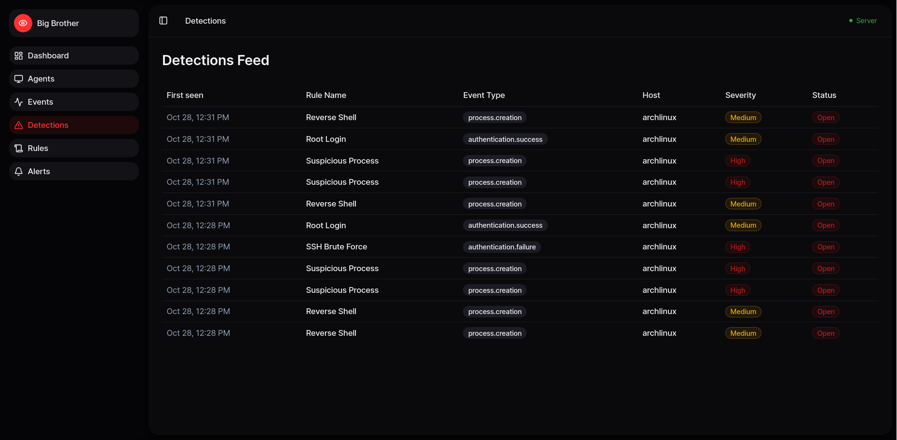
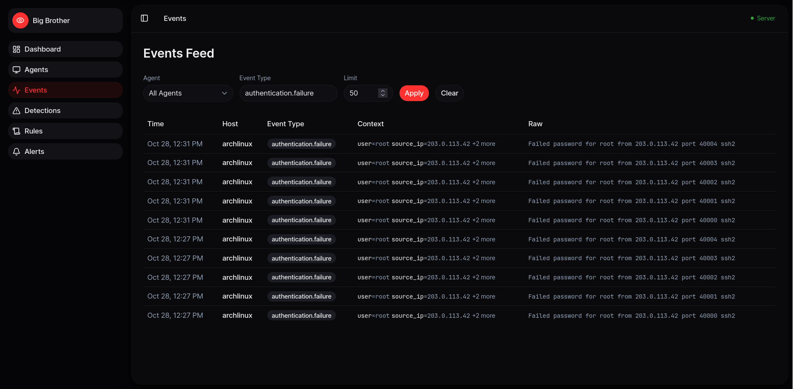
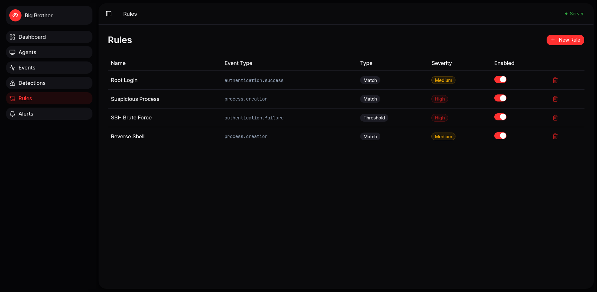
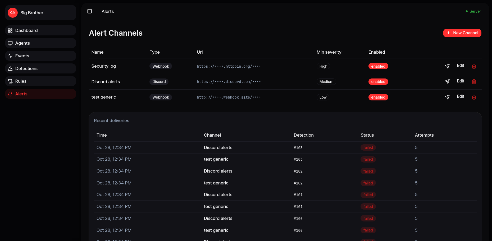
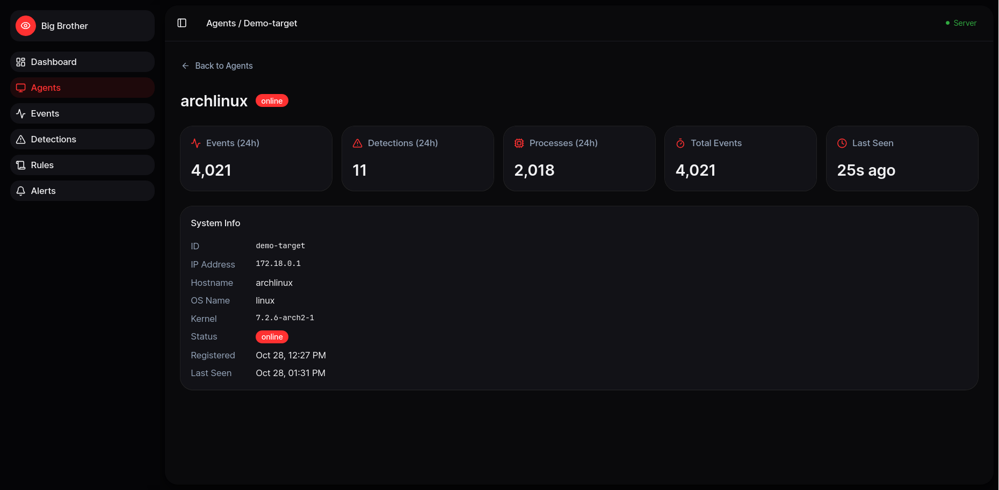

# Big Brother

**A tiny, self-hosted SOC for Linux.**

Process telemetry, SSH auth events, a rule engine you edit in the browser, and alerts to Slack, Discord or any webhook.



[](https://github.com/pratiksingh94/bigbrother/actions/workflows/ci.yml)
[](https://github.com/pratiksingh94/bigbrother/actions/workflows/images.yml)
[](LICENSE)

---

## Why

Wazuh is 2 GB of agent thats big as hell, a rule language that takes time to learn, and a
management server to go with it.

Big Brother is a **6 MB binary per host** and a
`docker compose up` for everything else, and the rules are edited **in the
browser itself, not in YAML**.

It is not a replacement for a full SIEM tho, its something that you use to learn and experiment with stuff, at least for now :3

## What it does

- **Process telemetry** - every process that starts or stops on a host, with its user, parent, command line and working directory
- **SSH auth events** - failed and successful logins from the journald
- **Rules** - two types, written in the dashboard:
  - `match` - fire when a field of the event has a value you list
  - `threshold` - fire when N events share a value inside a time window
- **Alerts** - Slack, Discord or any webhook, with retries and a delivery log so a failed alert are shown

## Try it

```bash
git clone https://github.com/pratiksingh94/bigbrother
cd bigbrother
docker compose up -d
```

The dashboard is on **http://localhost:3000**. The api is on
`http://localhost:8000`.

It starts with the rules in place but nothing else to show, so make something happen with demo script:

```bash
python3 scripts/demo.py
```

That posts a made up incident: someone brute forcing ssh from one address, getting in as root and starting netcat. The events go through the same pipeline as the ones a real agent sends, so the rules fire and the alerts go out on their own.

> The first `docker compose up` pulls the images from GitHub's registry. If
> that does not work for you, it falls back to building them from source.

## Watch a real machine

The agent is one static binary. On every host you want to watch:

```bash
curl -fsSL https://raw.githubusercontent.com/pratiksingh94/bigbrother/master/install.sh \
  | sh -s -- --server http://your-server:8000
```

It downloads the release that fits the machine, writes the config, installs a
systemd unit, starts the service and prints the id of the agent so you can find
the host in the dashboard.

<details>
<summary>Options</summary>

```
--server URL    url of the Big Brother server
--id ID         id of this agent, one is made when it is left out
--version TAG   release to install, the latest one by default
--uninstall     remove the agent and its service
```

The agent also takes flags directly, which is what you want when you run it by
hand:

```bash
lilbro --server http://your-server:8000
```

</details>

## Screenshots

**Detections** - every rule that fired, with the severity and what it matched on.


**Events** - the raw feed, filterable by agent and type.



**Rules** - the rule engine, edited in the browser.



**Alerts** - where the alerts go, and whether they arrived.



**An agent** - what a host is reporting.




<!-- ## How it works

```
  ┌───────────┐   events    ┌────────────┐   detections   ┌──────────┐
  │  lilbro   │ ──────────► │  backend   │ ─────────────► │  rules   │
  │ (per host)│  http/json  │ (fastapi)  │               │ (engine) │
  └───────────┘             └────────────┘               └──────────┘
                                    │                          │
                                    │                      ┌────▼─────┐
                                    │                      │  alerts  │
                                    ▼                      └──────────┘
                              ┌───────────┐
                              │ dashboard │  (next.js)
                              └───────────┘
``` -->

<!-- - **`lilbro/`** - the agent, in Go. Collects process and ssh events and ships
  them over http. It sends them as they happen and drops them when the server
  cannot be reached, so a short outage means a gap in the timeline rather than
  a growing backlog.
- **`backend/`** - a FastAPI service that stores the events, runs the rule
  engine every 30 seconds and sends the alerts.
- **`dashboard/`** - a Next.js app for the events, the detections, the rules and
  the alert channels. -->

## Configuration

### The server

| Variable | Where | Default | What |
|---|---|---|---|
| `DATABASE_URL` | backend | - | postgres connection string |
| `CORS_ORIGINS` | backend | `http://localhost:3000` | who may call the api |
| `NEXT_PUBLIC_API_URL` | dashboard build | `http://localhost:8000` | where the dashboard sends its calls |

`NEXT_PUBLIC_*` values end up inside the browser bundle, so they are baked in
when the image is built. Change it and rebuild:
`docker compose up -d --build`.

### The agent

| Flag | Environment | What |
|---|---|---|
| `--server` | `LILBRO_SERVER_URL` | url of the Big Brother server |
| `--id` | `LILBRO_AGENT_ID` | id of this agent, one is made when it is missing |
| `--config` | `LILBRO_CONFIG` | where the config file lives |

## Security

**Big Brother has NO authentication in v0.1.**

Read this before you put it anywhere on production (not recommended):

- Anyone who can reach the api can read every event, and can write fake ones.
- The default `docker-compose.yml` binds the api and the database to
  `127.0.0.1` so they are **not** reachable from the network. Do not change
  that without putting a reverse proxy with authentication in front of it.
- The agent runs as **root**, because it reads the journal for the ssh events and needs the full details of every process.
- The webhook urls are secrets. They are stored as they are given, but they are never sent back out, the api only ever shows a masked version.


## License

MIT, see [LICENSE](LICENSE).
